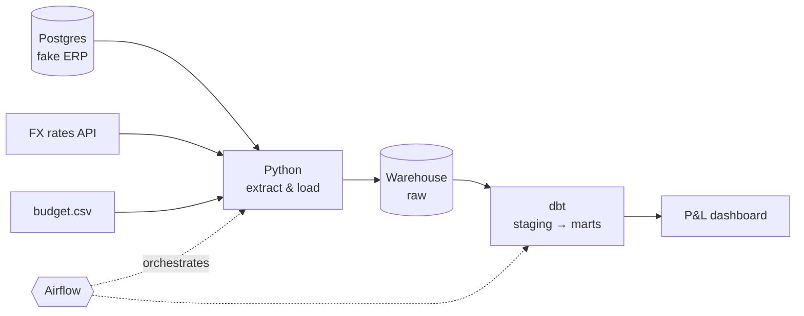

# FinPipe

A financial data pipeline built from scratch, the way a mid-sized company would need it.

I've worked in FP&A since 2018, and most of the reporting pain I've seen comes from the same place: the numbers live in an operational system, and someone rebuilds the P&L by hand every month. FinPipe is the version where nobody has to. It simulates a company's ERP, moves its data into a warehouse, models it into a P&L and checks its own quality along the way.

All the data is synthetic.

## Architecture



## Status

- [x] **Phase 1: Fake ERP.** Postgres in Docker with customers, products, invoices, invoice lines and payments. A seeded generator creates 2024–2026 history (3,000 invoices, ~9,000 lines, ~3,300 payments) and can be re-run safely.
- [ ] **Phase 2: Extract & load.** Postgres to DuckDB, full load first, then incremental.
- [ ] **Phase 3: Modeling with dbt.** Staging, star schema, monthly P&L vs budget.
- [ ] **Phase 4: Data quality.** dbt tests and reconciliations.
- [ ] **Phase 5: Orchestration.** Daily Airflow DAG.
- [ ] **Phase 6: Cloud.** Same pipeline on BigQuery.
- [ ] **Phase 7: Performance & dashboard.**

## Stack

Python · PostgreSQL · Docker · DuckDB · dbt · Airflow · BigQuery

## Run it

Requires Docker and Python 3.12.

```bash
docker compose up -d
uv venv && source .venv/bin/activate
uv pip install pandas sqlalchemy psycopg2-binary faker requests python-dotenv dbt-duckdb
docker exec -i finpipe_erp psql -U erp -d erp < generator/schema.sql
python generator/generate.py
```

## Early findings

Querying the fake ERP already surfaced something worth fixing: 57% of open receivables are over 90 days old, because the generator never writes off bad debt. That one will become a data quality test in Phase 4.
